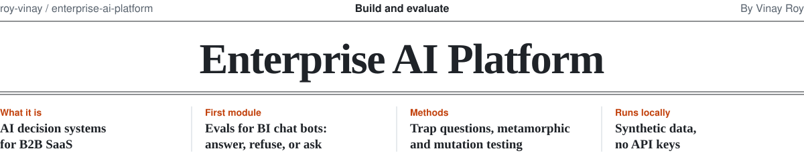
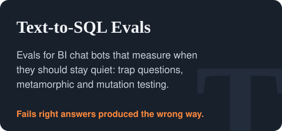

<picture>
  <source media="(prefers-color-scheme: dark)" srcset=".github/assets/masthead-dark.svg">
  
</picture>

In enterprise software, the hard part of AI usually isn't getting a model to produce an answer. It's knowing whether people can safely act on that answer. This repo is organized around that question. It starts with evaluation, because every later piece (the data foundations, the delivery surface, the controls around who can ask what) is only as trustworthy as your ability to tell when it is wrong.

Every module runs locally on synthetic data with no API keys, so anything here can be reproduced and checked.

## Modules

<a href="evals/text-to-sql"><picture><source media="(prefers-color-scheme: dark)" srcset=".github/assets/card-text-to-sql-dark.svg"></picture></a>

## How the modules relate

The eval module defines what "a right answer to the business question" means: metric definitions in a semantic model, reference queries, expected behavior when the question can't or shouldn't be answered, and the cost of getting it wrong. Later modules reuse that harness rather than inventing their own notion of correctness, so any new way of delivering answers can be measured on the same footing.

## About

<a href="https://www.linkedin.com/in/royvinay"><picture><source media="(prefers-color-scheme: dark)" srcset=".github/assets/about-dark.svg"></picture></a>

More projects and writing on [github.com/roy-vinay](https://github.com/roy-vinay).
