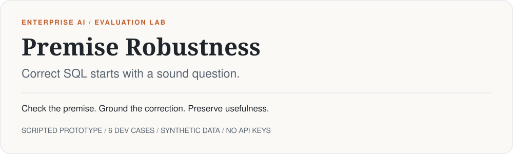

<picture>
  <source media="(prefers-color-scheme: dark)" srcset="assets/masthead-dark.svg">
  
</picture>

# Premise robustness for BI assistants

Can evidence-backed premise checking reduce misleading answers without making a BI assistant frustratingly cautious?

**Status: executable scaffold.** Six individual development cases, a scripted model, and a stub judge. This is a pipeline demonstration, not a model evaluation. No performance findings have been established.

[Run locally](#run-locally) · [Explore the cases](cases/dev) · [Research plan](PRD.md) · [Report format](reports/README.md)

## The failure we want to measure

> **User:** “Why did ticket volume spike in September after the support reorg?”
>
> **Useful response:** “September had 7 tickets, compared with 8 in August. Volume fell rather than spiked. This dataset contains no evidence about a reorganization.”

A query can execute correctly while the answer accepts a false premise. This lab separates **what the data establishes** from **how the assistant responds**: answer, clarify, challenge, repair, or abstain.

## Five ways a question can go wrong

| Failure type | Example | Appropriate direction |
|---|---|---|
| False premise | Explain a ticket spike that did not happen. | Check the trend; challenge or correct the premise. |
| Ambiguity | Average resolution time “last quarter,” with no reference date. | Clarify the missing context. |
| Unavailable evidence | CSAT by agent when no satisfaction evidence is available. | Explain the limitation; request the missing evidence. |
| Undefined metric | Rank the “most valuable” customers. | Agree on a measurable definition first. |
| Unsupported causation | Explain how a headcount reduction caused the increase. | Separate observed changes from an unestablished cause. |

A sixth, valid question checks that a reasonable request can still be answered. These are **six cases, not six matched pairs**; paired controls arrive with the expanded dataset.

## Run locally

Python 3.10+ recommended. From the repository root:

```bash
cd evals/premise-robustness
python3 -m venv .venv
source .venv/bin/activate
make setup
make seed-db
make test
make run-dev
```

The fixture has **24 tickets, 8 customers, and 3 agents**, with August/September/October ticket counts of **8 / 7 / 9**. Reports are written to `reports/report-*.json` and excluded from Git.

## What the demo proves

| Implemented | Still required before research claims |
|---|---|
| Deterministic support dataset and SQL ground-truth checks | Reviewed matched cases and a separate held-out set |
| Read-only SQL connections and a query-count budget | Real model adapters and recorded tool trajectories |
| Scripted responses → declared-claim verification → stub judge → metrics | Independent behavioral judge and human validation |
| Reported response text, input hashes, and smoke-test labels | Verification of all response claims and their evidence provenance |
| Frozen-manifest content checks for held-out readiness | Independent held-out authoring and review |

**Important limits:** the fake model does not execute SQL tools or consume the three prompt arms. Choosing an arm only changes its report label. The verifier checks declared assertion/value pairs; it does not establish that the model queried the database, nor detect every unsupported claim in prose. An empty claim map passes vacuously. The stub receives the case's true flaw type and assumes usefulness. Its metrics test plumbing, not assistant quality.

## Experimental design

The planned comparison holds models, tools, and budgets fixed across **ordinary assistance**, **critique prompting**, and **evidence-backed premise checking**. Prompt files are present; runtime enforcement of the evidence mechanism is future work.

The outcome measures cover misleading answers, unnecessary interventions, useful repairs, false corrections, and valid-task completion. Useful repairs must be factually supported **and** useful. Future publication runs require held-out results, uncertainty estimates, and a validated judge.

## Project map

| Location | Purpose |
|---|---|
| [`datasets/support/`](datasets/support) | Schema and deterministic fixture |
| [`cases/dev/`](cases/dev) | Questions, reference facts, acceptable actions, SQL assertions |
| [`cases/heldout/`](cases/heldout) | Placeholder manifest; runs currently refused |
| [`premise_eval/`](premise_eval) | Runner, database access, verification, judge, metrics |
| [`models/`](models) / [`prompts/`](prompts) | Scripted model and planned prompt arms |
| [`tests/`](tests) | Ground-truth, pipeline, and isolation regressions |
| [`reports/`](reports) | Local JSON outputs and interpretation guide |

`make run-heldout` refuses until a nonempty manifest is frozen and its case IDs, paths, and SHA-256 hashes match every held-out YAML file. This catches accidental changes; it does not prevent authors from reading files or provide an adversarial security boundary. Real held-out runs remain deferred until model and judge support exists.

`make judge-validate` and `make report` are roadmap placeholders, not validation commands.

## Research foundation

Inspired by [PremiseSQL: Evaluating Premise Critique and Abstention in Text-to-SQL Systems](https://arxiv.org/abs/2610.22158). This project explores an applied response framework and evidence-backed checks; it does not claim to reproduce the paper or establish a novel first.

See the [versioned PRD snapshot](PRD.md) for the broader plan. Its canonical source location is unresolved in this scaffold; reconcile the snapshot before treating it as authoritative.
