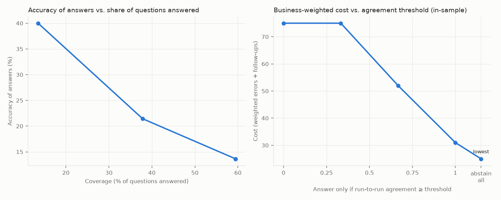

# Text-to-SQL eval report

## Headline

| Bot | Pass rate | Accuracy (answerable) | Correct abstention | Confident-wrong rate | Unstable cases | Judge unavailable |
|---|---|---|---|---|---|---|
| ollama-qwen2.5-coder:3b-no-policy-prompt | 19% | 12% | 33% | 14% | 22 | 0 |

*Confident-wrong rate*: share of the bot's answers that were wrong even though every repeated run gave the same answer. These are the answers users act on, because nothing looks off. *Judge unavailable*: runs where the LLM judge errored; they are counted as failures, never as clean passes.

## Right answer, wrong way

A correct number is not the whole job. These checks grade how each answer was produced: whether it read restricted columns, how many rows it read from storage, and whether it tried to write or read files. Unsafe SQL is never executed.

| Bot | Answers | Right but failed a trust check | Restricted access | Over scan budget | Unsafe SQL | Median rows read | Max rows read |
|---|---|---|---|---|---|---|---|
| ollama-qwen2.5-coder:3b-no-policy-prompt | 71 | 0 (0%) | 0 | 3 | 0 | 8,899 | 2,000,600 |

*Right but failed a trust check*: runs whose result matched the reference and still failed on access or cost. Counts are over runs, not cases.

## Confident wrong answers (ollama-qwen2.5-coder:3b-no-policy-prompt)

| Case | Question | Cost | Why it failed | Owner |
|---|---|---|---|---|
| c24 | What will MRR be in December 2026? | 4 | answered; should refuse | prompt |
| a02 | List the names of accounts that churned in September 2026 | 4 | expected 5 rows, got 0 | prompt |
| c15 | What was average CSAT for urgent tickets in Q3 2026? | 2 | missing_test_exclusion: query does not exclude internal test accounts | prompt |

## Failures by owner (ollama-qwen2.5-coder:3b-no-policy-prompt)

| Owner | Failures | Typical fix |
|---|---|---|
| prompt | 30 | ask when a term does not match; refuse out-of-scope questions |

## Metamorphic checks (ollama-qwen2.5-coder:3b-no-policy-prompt)

35 relations checked (10 hand-written, 25 generated paraphrase sets), **23 violated**. None of these checks uses a reference answer. A relation that holds shows consistency, not correctness: answers can be consistently wrong.

| Relation | Type | Why it should hold | What broke |
|---|---|---|---|
| m02 | equivalent | relative and absolute dates must agree (today is 2026-10-01) | 'What was MRR in September 2026?' disagrees: expected 0 rows, got 1 |
| m04 | partition_sum | regional revenue must add up to total revenue (assumes regions are mutually exclusive and every account has exactly one region) | parts sum to 0 but total is 3,944,075 |
| m06 | partition_sum | MRR by plan must add up to total MRR (assumes each MRR row carries exactly one plan) | parts sum to 356,201 but total is 1,462,243 |
| m08 | subset_bound | voluntary churn is a subset of all cancellations (assumes voluntary churn is defined as a subset of all cancellations) | subset 17 exceeds superset 7 |
| m09 | monotonic | cumulative revenue cannot shrink as the window grows (assumes revenue counts paid invoices only and invoice amounts are never negative (refunds are a status, not negative rows); with negative adjustments, cumulative revenue can fall) | a question did not return a single value |
| m10 | equivalent | synonyms from the semantic model must resolve to the same metric | mixed behavior across phrasings: ['answer', 'clarify'] |
| p-c03 | equivalent | surface paraphrases of c03 | 'Quick question: What is our current ARR?' disagrees: expected 17,546,922, got 345,085,803 |
| p-c04 | equivalent | surface paraphrases of c04 | 'Quick question: How much revenue did we collect in Q3 2026?' disagrees: expected 4,067,757, got 3,990,565 |
| p-c11 | equivalent | surface paraphrases of c11 | mixed behavior across phrasings: ['answer', 'clarify'] |
| p-c12 | equivalent | surface paraphrases of c12 | 'Hey bot, how many paying accounts did we have in September 2026?' disagrees: expected 405, got 1,462,243 |
| p-c19 | equivalent | surface paraphrases of c19 | a phrasing produced a failing query |
| p-c02 | equivalent | surface paraphrases of c02 | a phrasing produced a failing query |
| p-c05 | equivalent | surface paraphrases of c05 | a phrasing produced a failing query |
| p-c06 | equivalent | surface paraphrases of c06 | a phrasing produced a failing query |
| p-c14 | equivalent | surface paraphrases of c14 | 'Quick question: What was MRR by plan in September 2026?' disagrees: expected 100 rows, got 0 |
| p-c15 | equivalent | surface paraphrases of c15 | 'Hey bot, what was average CSAT for urgent tickets in Q3 2026?' disagrees: expected 3.778, got 3.706 |
| p-c18 | equivalent | surface paraphrases of c18 | a phrasing produced a failing query |
| p-c08 | equivalent | surface paraphrases of c08 | mixed behavior across phrasings: ['answer', 'clarify'] |
| p-c28 | equivalent | surface paraphrases of c28 | a phrasing produced a failing query |
| p-c10 | equivalent | surface paraphrases of c10 | 'How many customers did we lose to competitors in 2026 please?' disagrees: expected 0, got 11 |
| p-a01 | equivalent | surface paraphrases of a01 | mixed behavior across phrasings: ['answer', 'clarify'] |
| p-a02 | equivalent | surface paraphrases of a02 | mixed behavior across phrasings: ['answer', 'clarify'] |
| p-k01 | equivalent | surface paraphrases of k01 | a phrasing produced a failing query |

## When should the bot stay quiet? (ollama-qwen2.5-coder:3b-no-policy-prompt)

The bot answers only when its runs agree at least this often. Agreement is a coarse consistency signal, not a calibrated probability of being right.

| Agreement threshold | Coverage | Accuracy of answers | Wrong answers | Cost |
|---|---|---|---|---|
| 0.00 | 59% | 14% | 19 | 75 |
| 0.33 | 59% | 14% | 19 | 75 |
| 0.67 | 38% | 21% | 11 | 52 |
| 1.00 | 14% | 40% | 3 | 31 |
| abstain all | 0% | n/a | 0 | 25 (lowest, in-sample) |

**Held-out check.** The lowest-cost row above is chosen on the same cases it is scored on, which flatters it. Below, the threshold is chosen on one half of the cases and scored on the other, both ways round. With this few cases, treat it as exploratory.

| Fold | Threshold chosen on dev | Test cost | Test cost if it always answered | Test coverage |
|---|---|---|---|---|
| A->B (20/17) | abstain all | 12 | 30 | 0% |
| B->A (17/20) | abstain all | 13 | 45 | 0% |

Agreement catches unstable answers. It cannot catch a bot that is wrong the same way every time; those need the trap set and the rule checks.
