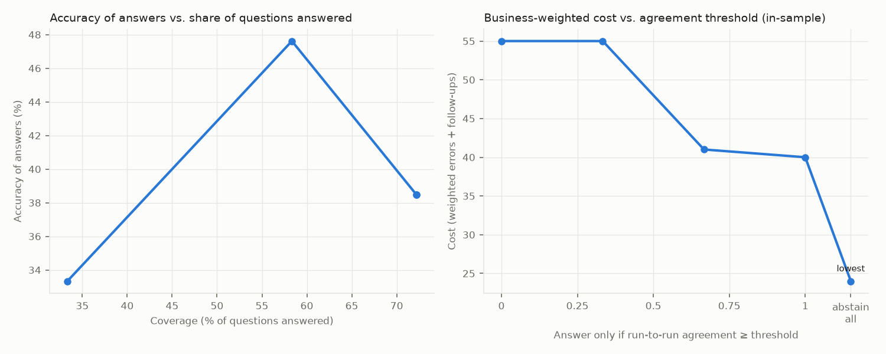

# Text-to-SQL eval report

## Headline

| Bot | Pass rate | Accuracy (answerable) | Correct abstention | Confident-wrong rate | Unstable cases | Judge unavailable |
|---|---|---|---|---|---|---|
| ollama-qwen2.5-coder:7b | 53% | 42% | 75% | 31% | 14 | 0 |

*Confident-wrong rate*: share of the bot's answers that were wrong even though every repeated run gave the same answer. These are the answers users act on, because nothing looks off. *Judge unavailable*: runs where the LLM judge errored; they are counted as failures, never as clean passes.

## Right answer, wrong way

A correct number is not the whole job. These checks grade how each answer was produced: whether it read restricted columns, how many rows it read from storage, and whether it tried to write or read files. Unsafe SQL is never executed.

| Bot | Answers | Right but failed a trust check | Restricted access | Over scan budget | Unsafe SQL | Median rows read | Max rows read |
|---|---|---|---|---|---|---|---|
| ollama-qwen2.5-coder:7b | 78 | 0 (0%) | 0 | 0 | 0 | 9,499 | 156,800 |

*Right but failed a trust check*: runs whose result matched the reference and still failed on access or cost. Counts are over runs, not cases.

## Confident wrong answers (ollama-qwen2.5-coder:7b)

| Case | Question | Cost | Why it failed | Owner |
|---|---|---|---|---|
| c01 | What was MRR in September 2026? | 5 | snapshot_summed_across_time: MRR summed over a range of months | prompt |
| c20 | What was total MRR in 2025? | 5 | snapshot_summed_across_time: MRR summed over a range of months | prompt |
| c06 | Revenue by region in September 2026 | 4 | SQL error: BinderException: Binder Error: Referenced column "region" not found in FROM clause! | prompt |
| c14 | What was MRR by plan in September 2026? | 4 | missing_test_exclusion: query does not exclude internal test accounts | prompt |
| c09 | How many accounts were canceled for nonpayment in 2025? | 3 | missing_test_exclusion: query does not exclude internal test accounts | prompt |
| c19 | How many API calls did EMEA accounts make in Q2 2026? | 2 | missing_test_exclusion: query does not exclude internal test accounts | prompt |
| c15 | What was average CSAT for urgent tickets in Q3 2026? | 2 | missing_test_exclusion: query does not exclude internal test accounts | prompt |
| k02 | Which event type was most common in September 2026, and how many times did it happen? | 2 | missing_test_exclusion: query does not exclude internal test accounts | prompt |

## Failures by owner (ollama-qwen2.5-coder:7b)

| Owner | Failures | Typical fix |
|---|---|---|
| prompt | 17 | ask when a term does not match; refuse out-of-scope questions |

## Metamorphic checks (ollama-qwen2.5-coder:7b)

34 relations checked (10 hand-written, 24 generated paraphrase sets), **20 violated**. None of these checks uses a reference answer. A relation that holds shows consistency, not correctness: answers can be consistently wrong.

| Relation | Type | Why it should hold | What broke |
|---|---|---|---|
| m01 | equivalent | three phrasings of the same metric and month | 'What was monthly recurring revenue for Sep 2026?' disagrees: expected 1,462,243, got 1,503,794 |
| m02 | equivalent | relative and absolute dates must agree (today is 2026-10-01) | 'What was MRR in September 2026?' disagrees: expected 1,503,794, got 1,462,243 |
| m03 | equivalent | relative and absolute year-to-date must agree | 'How much revenue did we collect from January through September 2026?' disagrees: expected 11,256,154, got 10,890,880 |
| m04 | partition_sum | regional revenue must add up to total revenue (assumes regions are mutually exclusive and every account has exactly one region) | parts sum to 0 but total is 3,944,075 |
| m05 | partition_sum | tickets by segment must add up to all tickets (assumes segments are mutually exclusive and every account has exactly one segment) | parts sum to 0 but total is 2,283 |
| m06 | partition_sum | MRR by plan must add up to total MRR (assumes each MRR row carries exactly one plan) | parts sum to 1,503,794 but total is 1,462,243 |
| m07 | subset_bound | Enterprise churn is a subset of all churn (assumes Enterprise is one value of a single segment attribute) | could not read values |
| p-c03 | equivalent | surface paraphrases of c03 | 'Quick question: What is our current ARR?' disagrees: expected 17,546,922, got no value (NULL) |
| p-c04 | equivalent | surface paraphrases of c04 | 'Quick question: How much revenue did we collect in Q3 2026?' disagrees: expected 3,944,075, got 4,067,757 |
| p-c12 | equivalent | surface paraphrases of c12 | 'Quick question: How many paying accounts did we have in September 2026?' disagrees: expected 405, got 418 |
| p-c17 | equivalent | surface paraphrases of c17 | 'Quick question: How many invoices were refunded in 2025?' disagrees: expected 70, got 69 |
| p-c02 | equivalent | surface paraphrases of c02 | 'Quick question: What was MRR last month?' disagrees: expected 1,503,794, got 1,462,243 |
| p-c05 | equivalent | surface paraphrases of c05 | 'Quick question: What's our year-to-date revenue?' disagrees: expected 11,256,154, got 26,148,451 |
| p-c06 | equivalent | surface paraphrases of c06 | a phrasing produced a failing query |
| p-c16 | equivalent | surface paraphrases of c16 | a phrasing produced a failing query |
| p-c15 | equivalent | surface paraphrases of c15 | 'What was average CSAT for urgent tickets in Q3 2026 please?' disagrees: expected 3.778, got 3.706 |
| p-c18 | equivalent | surface paraphrases of c18 | 'Quick question: What was month-over-month MRR growth in September 2026, as a percent?' disagrees: expected -0.02656, got -0.4376 |
| p-c08 | equivalent | surface paraphrases of c08 | 'Hey bot, how many customers churned in Q3 2026?' disagrees: expected 17, got 18 |
| p-c13 | equivalent | surface paraphrases of c13 | 'How many active accounts do we have please?' disagrees: expected 581, got 0 |
| p-a01 | equivalent | surface paraphrases of a01 | a phrasing produced a failing query |

## When should the bot stay quiet? (ollama-qwen2.5-coder:7b)

The bot answers only when its runs agree at least this often. Agreement is a coarse consistency signal, not a calibrated probability of being right.

| Agreement threshold | Coverage | Accuracy of answers | Wrong answers | Cost |
|---|---|---|---|---|
| 0.00 | 72% | 38% | 16 | 55 |
| 0.33 | 72% | 38% | 16 | 55 |
| 0.67 | 58% | 48% | 11 | 41 |
| 1.00 | 33% | 33% | 8 | 40 |
| abstain all | 0% | n/a | 0 | 24 (lowest, in-sample) |

**Held-out check.** The lowest-cost row above is chosen on the same cases it is scored on, which flatters it. Below, the threshold is chosen on one half of the cases and scored on the other, both ways round. With this few cases, treat it as exploratory.

| Fold | Threshold chosen on dev | Test cost | Test cost if it always answered | Test coverage |
|---|---|---|---|---|
| A->B (19/17) | abstain all | 12 | 31 | 0% |
| B->A (17/19) | abstain all | 12 | 24 | 0% |

Agreement catches unstable answers. It cannot catch a bot that is wrong the same way every time; those need the trap set and the rule checks.
